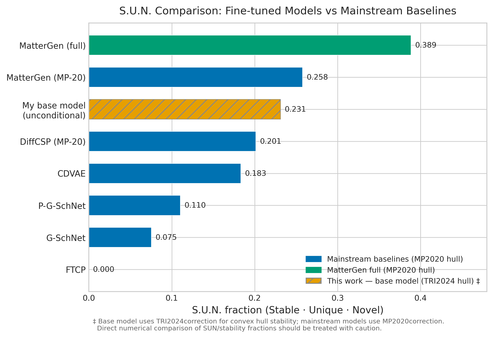
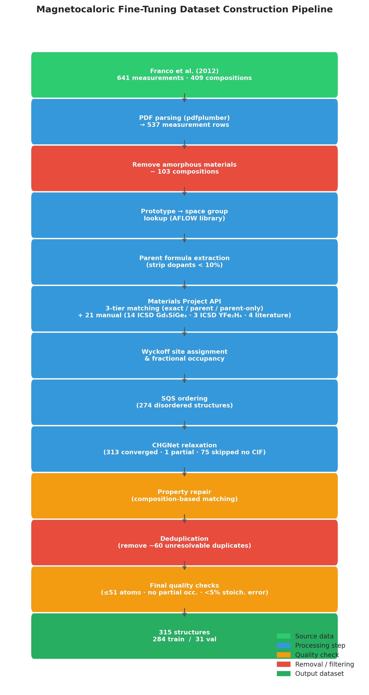

# MatterGen for magnetocaloric materials

[](https://github.com/ddemounteney1-png/mattergen-magnetocaloric-thesis/actions/workflows/tests.yml)

Code, data and results for my MEng thesis (University of Sheffield, 2026). I adapted Microsoft's [MatterGen](https://github.com/microsoft/mattergen) diffusion model to generate new crystal structures for magnetocaloric refrigeration, conditioned on the magnetic entropy change (ΔS) and Curie temperature (T<sub>C</sub>) of the material I want.

## Results

- **A base model trained from scratch** on 274,602 structures I assembled from Materials Project, COD and Alexandria reaches **23.1% stable-unique-novel (S.U.N.)** structures, against 25.8% for MatterGen trained on MP-20. My model is scored with the newer TRI2024 convex-hull correction, so the comparison is indicative rather than exact.
- **Fine-tuned on only 315 labelled magnetocaloric structures** (284 train / 31 validation), the model stays stable when asked for ΔS four standard deviations above the training mean, and shifts its chemistry towards known magnetocaloric elements (In, Gd, Er) as the ΔS target rises.
- **Four rare-earth-free candidates.** The lead, Si₂Fe₃Co, sits 0.011 eV/atom above the convex hull.
- **A 1,088-structure superconductor fine-tune** (1,000 train / 88 validation) checks that the transfer-learning pipeline works on a second property.



## Quickstart

```bash
git clone https://github.com/ddemounteney1-png/mattergen-magnetocaloric-thesis.git
cd mattergen-magnetocaloric-thesis
git lfs pull                      # CSV and pickle files are stored with Git LFS

# Run the tests
pip install -r requirements-test.txt
pytest

# Regenerate a thesis figure from the committed results (written to results/figures/)
python code/analysis/fig17_sun_comparison.py
```

To run the data pipelines, create the matching environment from `envs/` and set your Materials Project API key (get one at [materialsproject.org](https://next-gen.materialsproject.org/api)):

```bash
conda env create -f envs/data_pipeline.yml && conda activate data_pipeline
export MP_API_KEY=your-key-here   # or copy .env.example to .env and fill it in
python code/data_parsing/magnetocaloric_wyckoff_pipeline_v14.py
```

The pipelines write their intermediate files to `work/` (ignored by git). `code/project_paths.py` lists every folder and the environment variable that moves it.

## How it works



1. **Base dataset** (`code/base_dataset/`, stages 01–08). Pull structures from COD, Materials Project and Alexandria; drop partial occupancy, structures over 51 atoms and organics; annotate with NEMAD property labels; deduplicate with pymatgen's StructureMatcher (priority MP > COD > Alexandria); export a stratified 80/10/10 split in MatterGen's format.
2. **Magnetocaloric dataset** (`code/data_parsing/`, `code/structure_pipeline/`). Turn 409 literature compositions (Franco et al.) into crystal structures from Materials Project prototypes, order disordered alloys with special quasirandom structures, relax with CHGNet, and attach ΔS, T<sub>C</sub> and field labels.
3. **Training** (`configs/`). Pre-train the base model on 4× A100, then fine-tune property adapters on 1× A100 on Sheffield's Stanage cluster. The resolved Hydra configs record every hyperparameter.
4. **Evaluation and figures** (`code/analysis/`, `results/`). `mattergen-evaluate` output for every generation run is in `results/metrics/`, loss curves in `results/loss_curves/`, and each thesis figure has a script named after it.

## Repository structure

```
code/
  base_dataset/        8-stage pipeline for the 274,602-structure base dataset
  data_parsing/        magnetocaloric composition-to-structure pipeline
  structure_pipeline/  SQS ordering, CHGNet relaxation, dataset export
  analysis/            one script per thesis figure (fig01–fig29) + loss-log parsers
  slurm_scripts/       HPC job scripts (to be added)
  project_paths.py     every folder the scripts read or write
configs/               resolved Hydra configs and property-embedding definitions
data/                  source, fine-tuning, superconductor and base-dataset metadata CSVs
results/               metrics JSON, loss curves, figures (PNG + PDF)
checkpoints/           where the model weights are kept (not committed)
docs/                  pipeline reports: relaxation results, CIF quality, duplicates
envs/                  conda environments for each stage
tests/                 pytest suite, run on every push by GitHub Actions
```

## Reproducing training

Training ran on Sheffield's Stanage HPC with SLURM. The configs in `configs/` are the resolved versions of what ran. Fine-tuning reads the pre-trained model from `$PRETRAINED_MODEL_PATH`; see `configs/README.md`. The checkpoints are several GB each and are not in the repository; `checkpoints/README.md` describes each one.

## Data notes

- Structures come from [Materials Project](https://next-gen.materialsproject.org), the [Crystallography Open Database](https://www.crystallography.net/cod/), [Alexandria](https://alexandria.icams.rub.de) and NEMAD property labels; magnetocaloric properties come from the review by Franco et al. Each source has its own terms of use.
- CSV and pickle files are stored with Git LFS, so they won't preview on GitHub. Run `git lfs pull` after cloning.

## Known limitations

- 315 labelled structures is far below the dataset size MatterGen recommends for fine-tuning.
- The model is not conditioned on applied magnetic field, which ΔS depends on.
- My stability numbers use the TRI2024 hull correction and the published baselines use MP2020, so S.U.N. comparisons are approximate.
- The SLURM scripts and the joint ΔS + T<sub>C</sub> fine-tune config are still to be added.

## Citation and licence

If you use this work, please cite it using `CITATION.cff`. The code is released under the MIT licence (see `LICENSE`). MatterGen itself is © Microsoft and MIT-licensed.

**Daniel de Mounteney**, MEng General Engineering, University of Sheffield, 2026. Supervisor: Prof Nicola Morley.
